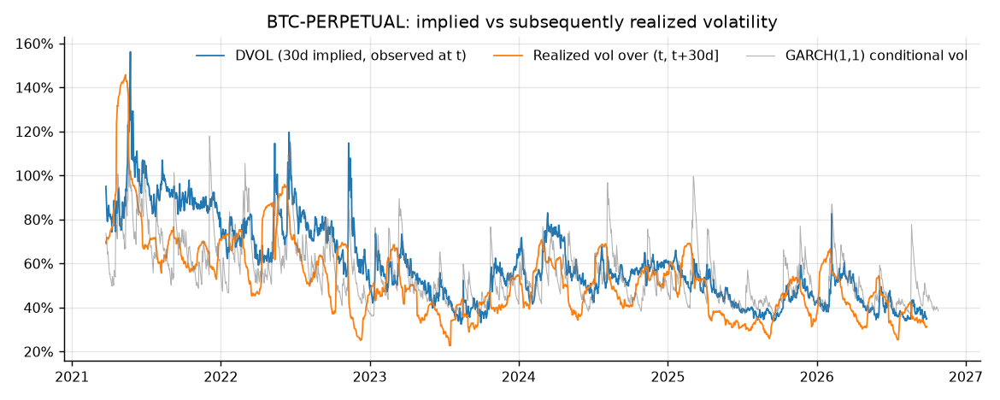
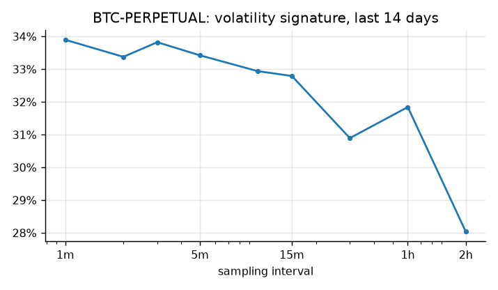

# volatility-engine

[](https://github.com/Thibautdqb/volatility-engine/actions/workflows/ci.yml)


Volatility of BTC and ETH perpetuals on Deribit: measured live, forecast, and compared with what the options market implies.

- **Live monitor.** Streams trades over WebSocket, builds bars, and updates realized-volatility estimators (EWMA, close-to-close with a confidence interval, Parkinson, Garman-Klass, Yang-Zhang) next to DVOL, Deribit's 30-day implied volatility index.
- **Research report.** Fits a GARCH(1,1) and runs an out-of-sample comparison of variance forecasts. It also tests whether implied volatility overprices realized volatility (the variance risk premium).

Only Deribit's public API is used, so no account or key is needed. Every reported number comes with an interval or a test, and the tests themselves are checked by simulation (see [Statistical design](#statistical-design)).

---

## Results

As of 2026-10-27. Reproduce them with `volengine report BTC-PERPETUAL` and `volengine report ETH-PERPETUAL`.

### Does a more complex model forecast better?

Walk-forward from 2021 with parameters re-estimated every 21 sessions. Each forecast is one day ahead. The forecast target is the sum of squared hourly returns over the 08:00 UTC session (Deribit's settlement time). The loss is QLIKE (Patton, 2011). DM is the Diebold-Mariano statistic against RiskMetrics (λ = 0.94); a negative value means lower loss.

| | BTC QLIKE | BTC DM (p) | ETH QLIKE | ETH DM (p) |
|---|---:|---:|---:|---:|
| Historical (21d) | 0.527 | +5.26 (<0.001) | 0.560 | +3.48 (<0.001) |
| EWMA λ = 0.94 | **0.442** | benchmark | 0.450 | benchmark |
| EWMA λ fitted (QLIKE) | 0.451 | +0.96 (0.34) | 0.446 | −0.42 (0.67) |
| GARCH(1,1) | 0.466 | +1.16 (0.24) | **0.443** | −0.27 (0.79) |

- A rolling historical estimator is significantly worse than any conditional model.
- Neither GARCH nor a fitted EWMA beats RiskMetrics with statistical significance, on either asset.
- GARCH forecasts are also biased: the Mincer-Zarnowitz test is rejected at p < 0.001 even though GARCH has the highest R². The EWMA forecasts are not rejected.

On BTC, the in-sample GARCH(1,1) fit gives persistence α + β = 0.968, a half-life of 21 sessions, and clean Ljung-Box and ARCH-LM tests on the squared standardized residuals. However, the robust standard error on α is 7× the classical one (0.196 against 0.028). With Gaussian errors, α looks highly significant; with robust errors, it does not. Most of the information comes from a few extreme days (−34% on 2020-03-12, Jarque-Bera ≈ 6300).

### Is implied volatility too high?



The test compares DVOL observed at time t with realized volatility over the following 30 sessions. Consecutive observations share 29 of 30 days, so a naive t-test is not valid (see below).

| | mean spread | 95% CI | Hansen-Hodrick p | 68 non-overlapping windows p | implied > realized |
|---|---:|---:|---:|---:|---:|
| BTC | +7.2 vol pts | [3.6, 10.8] | <0.001 | <0.001 | 73% of days |
| ETH | +4.7 vol pts | [−0.5, 9.9] | 0.075 | 0.027 | 66% of days |

- BTC implied volatility has systematically exceeded subsequent realized volatility since DVOL launched (March 2021).
- ETH shows the same sign, but the evidence is weaker and depends on the test used.
- The Mincer-Zarnowitz slope of realized variance on implied variance is 0.59 for BTC and 0.66 for ETH: implied variance overreacts.

### Which bar size for the live monitor?



Realized volatility from trade prices falls as the sampling interval grows, from about 34% at 1 minute to 28% at 2 hours. At very short intervals, the bid-ask bounce adds noise. The default of 1-minute bars stays in the flat part of the curve. Shorter bars are available but biased upward.

---

## Installation

```bash
git clone https://github.com/Thibautdqb/volatility-engine.git
cd volatility-engine
pip install -e ".[dashboard]"     # core only: pip install -e .
```

Python 3.10 to 3.12.

## Usage

```bash
volengine live                       # BTC and ETH, 1-minute bars, 120-bar window
volengine live BTC-PERPETUAL --bar 300 --window 96
volengine report BTC-PERPETUAL       # full study, about 15 s
streamlit run dashboard/app.py       # Live and Research views
```

`volengine live` prints one row per instrument and refreshes on every completed bar:

```
annualized volatility, 60s bars, window 120 bars   19:52:01 UTC

                   price   ewma     cc       cc 95% ci parkinson garman-klass yang-zhang   dvol  bars  lambda
BTC-PERPETUAL  80,652.50  21.1%  19.8%  [17.6%, 22.7%]     18.0%        17.3%      17.9%  37.3%   120  0.9546
ETH-PERPETUAL   2,344.85  32.5%  33.2%  [29.5%, 38.0%]     19.9%        14.9%      19.7%  53.1%   120  0.9426
```

As a library:

```python
from volengine.research import load_daily
from volengine.garch import fit_garch
from volengine.evaluation import walk_forward_forecasts, compare_forecasts

data = load_daily("ETH-PERPETUAL")
fit = fit_garch(data.returns)
print(fit.summary(), fit.diagnostics)
print(compare_forecasts(walk_forward_forecasts(data.returns), data.realized_variance))
```

---

## How it works

### Live monitor

1. **Seeding.** On start, the monitor downloads the last 2,000 completed one-minute trade bars from the REST API. They warm up the estimators, and the EWMA decay λ is fitted on them.
2. **Live bars.** It then subscribes to `trades.{instrument}.100ms` and `deribit_volatility_index.{index}`. Live bars come from the same trade prints as the historical candles, so seeded and live bars form one continuous series, without duplicates or a break in definition.
3. **Disconnections.** The heartbeat and exponential-backoff reconnection are handled. After a reconnection, the monitor re-seeds from REST so that the gap is filled with real bars, not flat ones.

### Estimators

Variances are per bar and annualized over 365 days (crypto trades continuously).

| estimator | per-bar variance | note |
|---|---|---|
| close-to-close | r² (zero mean) | χ² 95% interval in the live view |
| Parkinson | (ln H/L)² / 4 ln 2 | ~5× more efficient under GBM |
| Garman-Klass | ½(ln H/L)² − (2 ln 2 − 1)(ln C/O)² | ~7× |
| Rogers-Satchell | ln(H/C) ln(H/O) + ln(L/C) ln(L/O) | robust to drift |
| Yang-Zhang | σ²_open + k σ²_open-close + (1−k) σ²_RS | robust to drift and jumps |
| EWMA | σ²_t = λ σ²_{t−1} + (1−λ) r²_{t−1} | λ fitted by minimizing QLIKE |

### GARCH(1,1)

- **Estimation**: Gaussian quasi-maximum likelihood, on returns rescaled to unit variance.
- **Variance recursion**: computed as an IIR filter (`scipy.signal.lfilter`), about 50 ms for 3,000 observations.
- **Standard errors**: Bollerslev-Wooldridge robust (sandwich).
- **Validation**: parameters, standard errors and log-likelihood are tested against the `arch` package.

### Daily data

- **Sessions**: built from hourly bars on the 08:00 UTC boundary. A session's return is the sum of its hourly log returns, so it covers exactly the same window as its realized variance. Incomplete sessions are dropped.
- **DVOL alignment**: the close of each UTC day is assigned to the session that opens 8 hours later, so implied volatility is always known before the window it is compared with. There is no look-ahead.

## Statistical design

| question | test | why |
|---|---|---|
| Is there volatility clustering? | ARCH-LM (Engle, 1982) | justifies conditional models |
| Is the GARCH fit adequate? | Ljung-Box on z², ARCH-LM on z | remaining ARCH effects |
| Are parameters significant? | sandwich standard errors | returns are far from Gaussian |
| Does model A forecast better than B? | Diebold-Mariano, HAC variance, Harvey-Leybourne-Newbold correction | loss differentials are autocorrelated |
| Is a forecast unbiased? | Mincer-Zarnowitz, Wald a = 0, b = 1, HAC | |
| Loss function | QLIKE | robust to the noise in the realized-variance proxy |
| Implied minus realized, overlapping windows | Hansen-Hodrick, t(n/h − 1), plus non-overlapping windows as a robustness check | Newey-West rejects ~12% of the time at a nominal 5% here; Hansen-Hodrick 5.4% (simulated, n = 900, h = 30) |
| Interval on realized volatility | stationary block bootstrap (report), χ² (live) | the bootstrap does not assume iid Gaussian returns |

The test suite checks the size of the Diebold-Mariano, Hansen-Hodrick and variance-risk-premium tests under the null, and the coverage of the χ² and bootstrap intervals. The HAC, Ljung-Box, ARCH-LM and OLS implementations are compared with statsmodels.

## Limitations

- **Realized-variance proxy.** Hourly realized variance is noisy. Finer sampling would reduce the noise but adds microstructure bias.
- **Live χ² interval.** It assumes iid Gaussian returns, which makes it too narrow when volatility clusters. It is computed live because it is cheap. The report uses the block bootstrap instead.
- **Thin bars.** On ETH at 1 minute, close-to-close and range estimators diverge (33% against 20% in the example above). With fewer trades per bar, the observed range understates the true range, and closes bounce between bid and ask. For ETH, prefer 5-minute bars (`--bar 300`).
- **Scope.** Only Deribit perpetuals and DVOL (BTC and ETH) are covered.

## Project layout

```
src/volengine/
  estimators.py   realized volatility estimators, EWMA, confidence intervals, cone, signature plot
  garch.py        GARCH(1,1) QMLE, robust standard errors, forecasts, diagnostics
  stats.py        HAC, Hansen-Hodrick, Diebold-Mariano, Mincer-Zarnowitz, Ljung-Box, ARCH-LM, bootstrap
  evaluation.py   walk-forward forecasts and loss comparison
  research.py     daily sessions, variance risk premium, full report
  live.py         bar aggregation, streaming EWMA, live monitor
  deribit/        REST client (paginated) and WebSocket stream (heartbeat, reconnect)
  cli.py
dashboard/app.py  Streamlit front-end
scripts/          figure generation
tests/            unit tests + integration tests against Deribit (pytest -m network)
```

```bash
pip install -e ".[dev]"
pytest -m "not network"
pytest -m network
ruff check . && ruff format --check .
```

## References

- Andersen, Bollerslev, Diebold & Labys (2000). Great realizations. *Risk*.
- Bollerslev & Wooldridge (1992). Quasi-maximum likelihood estimation and inference in dynamic models with time-varying covariances. *Econometric Reviews*.
- Diebold & Mariano (1995). Comparing predictive accuracy. *JBES*. Harvey, Leybourne & Newbold (1997) for the small-sample correction.
- Hansen & Hodrick (1980). Forward exchange rates as optimal predictors of future spot rates. *JPE*.
- Hansen & Lunde (2005). A forecast comparison of volatility models: does anything beat a GARCH(1,1)? *JAE*.
- Patton (2011). Volatility forecast comparison using imperfect volatility proxies. *J. Econometrics*.
- Yang & Zhang (2000). Drift-independent volatility estimation based on high, low, open, and close prices. *J. Business*.

## License

MIT
