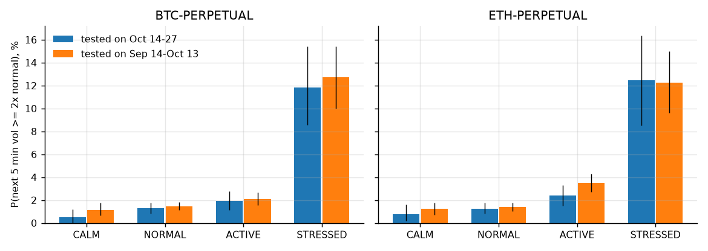

# volatility-engine

[](https://github.com/Thibautdqb/volatility-engine/actions/workflows/ci.yml)


Real-time five-minute volatility forecast and market-regime classifier for BTC and ETH perpetuals on Deribit, with a short-term spike detector.

Every 10 seconds, from the live trade feed (WebSocket), the monitor answers two questions:

- **How much will the market move over the next 5 minutes?** It gives a volatility forecast, the matching one-standard-deviation price move, and a regime: `CALM`, `NORMAL`, `ACTIVE` or `STRESSED`.
- **Is something happening right now?** The spike detector compares the volatility of the last minute with the normal level.

Everything is fitted on past trades and checked on days the model has never seen. Direction was tested as well: no signal was found that predicts it (see [What does not work](#what-does-not-work)). Only Deribit's public API is used, so no account or key is needed.

```
10:33:40 UTC | regime = forecast of the next 5 minutes | spike = vol 1m vs normal (30m): elevated >= 2x, spike >= 3x

                 price regime    for next 5m vol vs normal 1sd 5m  spike vol 1m normal move 1m  dvol
BTC-PERPETUAL 81,451.0 NORMAL 22m00s       21.4%     0.86x  53.65 NORMAL  27.2%  24.9%  +2.2bp 37.1%
ETH-PERPETUAL  2,367.8 NORMAL  0m30s       23.9%     0.77x   1.74 NORMAL  27.3%  31.1%  +1.5bp 52.5%

alerts
10:07:00  ETH-PERPETUAL  regime   normal -> stressed  next 5m  40.5% (1.14x)  vol 1m  65.2% (1.84x)  move 1m -10.3bp  @ 2,367.8  (history)
08:35:40  ETH-PERPETUAL  spike    normal -> elevated  next 5m  84.5% (1.46x)  vol 1m 158.7% (2.74x)  move 1m +38.1bp  @ 2,379.8  (history)
08:35:40  BTC-PERPETUAL  spike    normal -> elevated  next 5m  45.4% (1.46x)  vol 1m  72.2% (2.33x)  move 1m +18.3bp  @ 81,547.5  (history)
```


*One out-of-sample example, chosen because it is easy to read: the model was fitted on September only and is drawn here on 2026-10-14.*

- The forecast (blue) sits in `ACTIVE` and `STRESSED` from 12:00, after a first burst of activity.
- It is back in `STRESSED` at 12:28. US data are released at 12:30 UTC, and the time-of-day term knows that this slot is usually volatile.
- At 12:30, BTC falls 0.9% in 30 seconds, and the realized volatility of the next five minutes reaches 10× normal. The spike detector (red dots) fires only once the move has happened.
- After the shock, the forecast decays faster than the one-minute volatility, and the regime leaves `STRESSED` at 12:38.

The statistics below are what to judge the model on.

---

## Results (out of sample)

Data: every Deribit trade over 44 days, 11.1 million on BTC and 4.2 million on ETH, cut in two periods:

- **Sep**: 2026-09-14 to 2026-10-13;
- **Oct**: 2026-10-14 to 2026-10-27.

The model is fitted on one period and scored on the other, in both directions. Scored windows are non-overlapping five-minute windows. Intervals are 95%, from a stationary block bootstrap with one-hour blocks.

### Accuracy of the five-minute forecast

Out-of-sample R² of log(realized vol over the next 5 minutes / normal vol):

| forecast | BTC, tested on Oct | BTC, tested on Sep | ETH, tested on Oct | ETH, tested on Sep |
|---|---:|---:|---:|---:|
| unchanged normal level | −0.12 | −0.12 | −0.13 | −0.14 |
| volatility of the last 5 minutes | −0.18 | −0.23 | −0.13 | −0.24 |
| volatility of the last minute (spike detector) | −0.26 | −0.28 | −0.18 | −0.29 |
| **model** | **+0.17** | **+0.14** | **+0.17** | **+0.13** |
| MSE reduction vs last 5 minutes, 95% CI | [0.040, 0.056] | [0.056, 0.073] | [0.035, 0.047] | [0.058, 0.072] |
| Mincer-Zarnowitz slope (1 = unbiased scale) | 0.97 | 0.93 | 0.97 | 0.90 |

- Over five minutes, simply carrying forward the recent volatility is worse than assuming the normal level, because short-term volatility mean-reverts quickly.
- The model explains 13 to 17% of the variance of log volatility, which is a good result for a noisy five-minute target.
- The Mincer-Zarnowitz slope stays close to 1 out of sample: the forecasts have the right scale, without over- or under-reaction.

### Regimes



Share of five-minute windows that turn out *violent* (realized vol at least 2× normal), by the regime shown at the start of the window:

| regime | share of time | realized vol / normal (median) | P(violent), BTC | P(violent), ETH | spike detector not firing |
|---|---:|---:|---:|---:|---:|
| `CALM` | 13–20% | 0.69–0.74 | 0.5–1.2% | 0.8–1.2% | 100% |
| `NORMAL` | 48–52% | 0.82–0.84 | 1.3–1.5% | 1.3–1.4% | 100% |
| `ACTIVE` | 25–27% | 0.95–0.98 | 1.9–2.1% | 2.4–3.5% | 96–99% |
| `STRESSED` | 6.5–8% | 1.17–1.27 | **11.8–12.7%** | **12.3–12.5%** | **64–68%** |

Ranges cover the two test directions. The full tables with intervals are printed by `volengine study`.

- A violent five minutes is 8 to 10 times more likely in `STRESSED` than in `NORMAL`, and 10 to 25 times more likely than in `CALM`, for both assets and in both directions. The intervals do not overlap.
- Two thirds of the `STRESSED` windows begin while the spike detector is still quiet. The regime is a warning ahead of the move, not a restatement of it.
- `CALM` windows are genuinely quiet, at 0.7× normal. For a market maker or a stop placement, that is as useful as the warning.

### What does not work

`scripts/feature_search.py` reproduces the full search.

- **More inputs for volatility.** Order-flow imbalance, liquidation volume and the perpetual-index basis add nothing out of sample beyond the six terms used.
- **Direction.** Several candidates were tested for predicting the sign of the next 1, 5 and 15 minutes:
  - trade imbalance over the last minute;
  - the last move;
  - Deribit's spot index moving before the perpetual;
  - changes in the basis.

  Every Spearman correlation is below 0.05 in absolute value, and a third of them change sign between periods. The most stable pattern is a mild reversal over 15 minutes after a large one-minute move. Fading moves beyond 2 standard deviations earns 1.5 to 3 bp on average. That is not significant (t-statistics between 0.9 and 1.4) and is below the 10 bp round-trip taker fee. **This tool tells you how much the market is likely to move, not which way.**

### Spike detector

The detector flags a move as it happens, so it is coincident by design. When it is flagged, the next five minutes are violent 6 to 10 times more often than when it is not; the 95% intervals start at 4 in every period and asset. After an alert, the excess volatility halves in about 10 minutes:


## Dashboard

`streamlit run dashboard/app.py` shows the same monitor with charts, refreshed every second:

- price, with spike alerts as red dots;
- forecast, realized and normal volatility;
- `ACTIVE` and `STRESSED` periods shaded;
- the alert list.


## What each column means

| column | meaning | use |
|---|---|---|
| `regime` | forecast class for the next 5 minutes; rises at once, falls after one minute below its threshold | size, spreads, pausing a strategy |
| `for` | time in the current regime | |
| `next 5m vol` | forecast volatility over the next 5 minutes, annualized | |
| `vs normal` | the same divided by the 30-minute normal volatility | unit-free; the regime cut points are on this scale |
| `1sd 5m` | one-standard-deviation price move over the next 5 minutes, in USD | stop distance, quote width |
| `spike` | `NORMAL`, `ELEVATED` (vol 1m ≥ 2× normal) or `SPIKE` (≥ 3×) | something is happening now |
| `vol 1m`, `normal` | realized volatility, EWMA half-lives of 1 and 30 minutes, annualized | |
| `move 1m` | price change over the last minute, in bp | the direction of what just happened |
| `dvol` | Deribit's 30-day implied volatility index | context from the options market |

Alerts are raised when the regime enters `STRESSED` (it re-arms once back to `NORMAL` or `CALM`) and when the spike detector escalates. With `--log`, they are written one JSON object per line:

```json
{"time": "2026-10-28T10:07:00+00:00", "instrument": "ETH-PERPETUAL", "kind": "regime", "previous": "normal", "level": "stressed", "forecast_ratio": 1.139505, "forecast_vol": 0.405181, "ratio": 1.83287, "fast_vol": 0.651725, "slow_vol": 0.355576, "price": 2367.8, "move_1m": -0.001034, "dvol": null, "live": false}
```

- **History alerts.** Alerts found in the four hours of trades loaded at start-up are listed with the mark `(history)` so the list matches the charts, but they are not written to the log.
- **The record above.** It is one of those, which is why `live` is false and `dvol` is null. A live alert carries the current DVOL.

## Usage

```bash
git clone https://github.com/Thibautdqb/volatility-engine.git
cd volatility-engine
pip install -e ".[dashboard]"     # core only: pip install -e .
```

```bash
volengine live                                   # BTC and ETH
volengine live BTC-PERPETUAL --log alerts.jsonl --bell
streamlit run dashboard/app.py
volengine study ETH-PERPETUAL --end 2026-10-28   # fit on 30 days, score on the next 14
volengine fit --days 44 --out models.json        # re-estimate; use with live --models
```

- **Start-up.** The monitor downloads the last four hours of trades (about 5 seconds), so that the normal volatility and the forecast are warm from the first bar.
- **Cache.** `volengine study` and `volengine fit` cache downloaded days in `~/.cache/volengine`. The first download of 44 days takes 15 to 30 minutes; later runs take seconds.

From Python:

```python
from volengine.live import LiveMonitor

monitor = LiveMonitor(["BTC-PERPETUAL"], on_alert=lambda a: print(a.as_dict()))
monitor.start_background()  # or: await monitor.run()
monitor.snapshot("BTC-PERPETUAL")  # Snapshot(regime=..., forecast_vol=..., sigma_5m=..., ...)
```

## The model

Bars are 10 seconds long. *Normal* is an EWMA of squared returns with a 30-minute half-life. The forecast is ordinary least squares on non-overlapping five-minute windows:

```
log(vol next 5m / normal) = c + b1·x1 + b5·x5 + b30·x30 + bs·season + bt·trades + bm·absmove
```

| term | definition | BTC coefficient (shipped) |
|---|---|---:|
| `x1`, `x5`, `x30` | log(realized vol over the last 1, 5, 30 min / normal) | −0.004, +0.200, +0.167 |
| `season` | log volatility of the coming 5-minute slot of the day relative to the daily average, from the training days | +0.806 |
| `trades` | log(trades in the last minute / average per minute over 30 minutes) | +0.067 |
| `absmove` | \|price change over the last minute\| in normal standard deviations | +0.061 |

- **The terms.** The first three are the HAR model of Corsi (2009) moved to intraday horizons; the 5- and 30-minute volatilities carry most of the information. The time-of-day term captures the US open and scheduled releases. Each added term improves the out-of-sample R² in all four tests (`scripts/feature_search.py`).
- **The regimes.** Cut points are the 25th, 75th and 95th percentiles of the forecast on the training data. On BTC, a forecast below 0.78× normal is `CALM` and one above 1.15× is `STRESSED`.
- **Shipped coefficients.** The coefficients in `src/volengine/models.json` are fitted on all 44 days. ETH's are within 0.03 of BTC's. The out-of-sample results above use models fitted on one period only.

## How it is built

- **Data.** Live bars come from the `trades.{instrument}.100ms` WebSocket channel; measured latency from exchange timestamp to receipt is 150 to 190 ms median and about 330 ms at the 95th percentile. Historical bars come from the same trades on `history.deribit.com`. A bar's price is its last trade, and a bar without a trade keeps the previous price.
- **One code path.** The streaming and batch implementations of the sampler, the detector and the forecast are tested to give identical numbers, to 1e-9. The figures above are therefore exactly what the live monitor would have shown.
- **Start-up and reconnection.** The monitor subscribes first and buffers, then downloads recent history and runs the models over it. It then replays the buffered trades that the download missed, matching them by trade id. After a disconnection it does the same again, so the gap is filled with real trades.
- **Clock.** Bars close on exchange time even when no trade prints: the DVOL feed ticks twice a second and closes any bar that ended more than a second earlier.

## Statistical design

- **No look-ahead.** Every input is known at the close of the bar, and the target uses only later returns. The time-of-day profile and the regime cut points come from the training period only.
- **Both directions.** Each model is scored on a period it was not fitted on, forward in time and backward. The four results agree.
- **Dependence.** Neighbouring windows are not independent, so intervals use the stationary bootstrap (Politis & Romano, 1994) with one-hour blocks.
- **Market closures.** Five-minute windows without any price change at all (about 40 per instrument in 44 days) are dropped from fitting and scoring.
- **Checks under the null** (in `tests/`):
  - With constant volatility, the forecast has no skill (R² < 0.02), and the spike detector raises no alert with Gaussian returns.
  - With independent jumps, alerts fire but predict nothing.
  - On simulated volatility clusters, the forecast beats the naive ones.

## Limitations

- **44 days.** Both periods belong to one market environment. The time-of-day profile in particular should be re-estimated regularly with `volengine fit`.
- **Trade prices, not quotes.** Deribit publishes no historical order book, so both the study and the monitor use trades to stay identical.
- **The first jump.** A third of the `STRESSED` windows only start once the spike detector is already firing. A move that comes out of nowhere is still seen only when it happens.
- **Not a trading signal by itself.** The model forecasts the size of moves, not their direction.

## Project layout

```
src/volengine/
  forecast.py     five-minute forecast, regimes (batch and streaming)
  detector.py     spike detector: fast/slow EWMA ratio with hysteresis
  sampling.py     trades -> 10-second bars (batch and streaming, identical)
  live.py         live monitor: seeding, buffering, alerts, snapshots
  study.py        out-of-sample evaluation, model fitting, trade cache
  stats.py        stationary bootstrap, Wilson interval
  models.json     shipped coefficients
  deribit/        REST trade history and WebSocket stream (heartbeat, reconnect)
  cli.py
dashboard/app.py  Streamlit front-end
scripts/          figures, feature search
tests/            unit tests + integration tests against Deribit (pytest -m network)
```

```bash
pip install -e ".[dev]"
pytest -m "not network"
pytest -m network
ruff check . && ruff format --check .
```

## References

- Andersen, Bollerslev, Diebold & Labys (2000). Great realizations. *Risk*.
- Corsi (2009). A simple approximate long-memory model of realized volatility. *Journal of Financial Econometrics*.
- Mincer & Zarnowitz (1969). The evaluation of economic forecasts. *NBER*.
- Politis & Romano (1994). The stationary bootstrap. *JASA*.
- J.P. Morgan / Reuters (1996). *RiskMetrics Technical Document*.

## License

MIT
