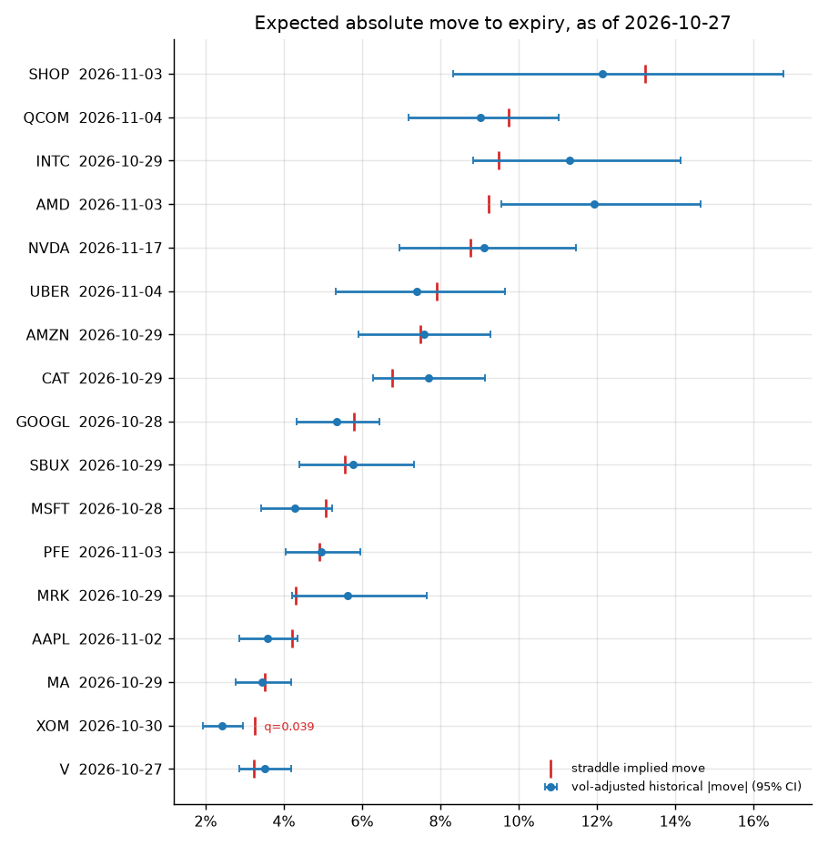

# volatility-engine

[](https://github.com/Thibautdqb/volatility-engine/actions/workflows/ci.yml)


Realized and implied volatility toolkit, in three layers:

1. **Streaming estimators on Deribit.** WebSocket ticks are aggregated into bars and update an O(1) EWMA variance and range-based estimators (Parkinson, Garman-Klass, Yang-Zhang), with DVOL alongside. Public channels only, so no API key is needed.
2. **Forecast evaluation.** GARCH(1,1) by QMLE with robust standard errors. EWMA, fitted EWMA, GARCH and a historical benchmark are compared out of sample under a walk-forward protocol, with Diebold-Mariano and Mincer-Zarnowitz tests. The DVOL variance risk premium is tested with overlap-robust inference.
3. **Earnings extension.** For equities with an announcement in the next few weeks, the ATM straddle implied move (and the event-only move extracted from the term structure) is compared with the vol-adjusted historical distribution of announcement moves. P-values are controlled for false discoveries across the universe.

Every reported number comes with an interval or a test. Every test was checked for size by simulation (see [Statistical design](#statistical-design)).

---

## Results

As of 2026-10-27. Reproduce them with `volengine report BTC-PERPETUAL`.

### Forecasting daily variance, out of sample

Walk-forward from 2021 with parameters re-estimated every 21 sessions. Each forecast is one step ahead. The proxy is the sum of squared hourly returns over the 08:00 UTC session. The loss is QLIKE (Patton, 2011). DM is the Diebold-Mariano statistic against RiskMetrics (λ = 0.94); a negative value means lower loss.

| | BTC QLIKE | BTC DM (p) | ETH QLIKE | ETH DM (p) |
|---|---:|---:|---:|---:|
| Historical (21d) | 0.527 | +5.26 (<0.001) | 0.560 | +3.48 (<0.001) |
| EWMA λ = 0.94 | **0.442** | benchmark | 0.450 | benchmark |
| EWMA λ fitted (QLIKE) | 0.451 | +0.96 (0.34) | 0.446 | −0.42 (0.67) |
| GARCH(1,1) | 0.466 | +1.16 (0.24) | **0.443** | −0.27 (0.79) |

- The rolling historical estimator is significantly worse than any conditional model.
- **Neither GARCH nor a fitted EWMA beats RiskMetrics with statistical significance**, on either asset. At this horizon, extra parameters buy nothing detectable. That is consistent with Hansen & Lunde (2005).
- GARCH forecasts are biased: the Mincer-Zarnowitz test of a = 0, b = 1 is rejected (p < 0.001) even though GARCH has the highest R². The EWMA forecasts are not rejected.

On BTC, the in-sample GARCH(1,1) fit gives persistence α + β = 0.968, a half-life of 21 sessions, and clean Ljung-Box and ARCH-LM tests on the squared standardized residuals. However, the robust standard error on α is **7× the classical one** (0.196 against 0.028). With Gaussian errors, α looks highly significant; with robust errors, it does not. Most of the information comes from a handful of extreme days (−34% on 2020-03-12, Jarque-Bera ≈ 6300). This is why robust errors are the default here.

### Variance risk premium


The test compares DVOL observed at time t with realized volatility over the following 30 sessions. The windows overlap by 29 of 30 days, so a naive t-test is not usable (see below).

| | mean spread | 95% CI | Hansen-Hodrick p | 68 non-overlapping windows p | implied > realized |
|---|---:|---:|---:|---:|---:|
| BTC | +7.2 vol pts | [3.6, 10.8] | <0.001 | <0.001 | 73% of days |
| ETH | +4.7 vol pts | [−0.5, 9.9] | 0.075 | 0.027 | 66% of days |

- BTC implied volatility has systematically overpriced subsequent realized volatility since DVOL launched (2021).
- On ETH the sign is the same, but the evidence is weaker and depends on the test.
- The Mincer-Zarnowitz slope of realized variance on implied variance is 0.59 for BTC and 0.66 for ETH: implied variance overreacts.

### Earnings straddles



The 17 large caps reporting in the two weeks after 2026-10-27 were screened. For each ticker, the red tick is the ATM straddle implied move to the first expiry after the announcement. The blue dot is the historical move over the same horizon (same number of sessions before the event, same holding length), rescaled to today's volatility.

- Only **XOM** passes the 10% false discovery rate threshold (q = 0.039): the straddle prices a 3.3% move against 2.4% expected.
- AMD has a raw p-value close to 0.05, but it does not survive the correction for 17 simultaneous tests.
- Lesson: with about 60 announcements per name, single-stock earnings edges are usually too small to tell apart from noise. This screener is built to say so.

### Sampling frequency


Realized volatility from trade prices falls as the sampling interval grows, from 34% at 1 minute to 28% at 2 hours. This is the signature of microstructure noise. The live monitor therefore uses the **mark price** (an index-based price that does not bounce between bid and ask). For trade-price bars, an interval of at least 5 minutes is preferable.

---

## Installation

```bash
git clone https://github.com/Thibautdqb/volatility-engine.git
cd volatility-engine
pip install -e ".[earnings,dashboard]"   # core only: pip install -e .
```

Python 3.10 to 3.12. Data sources: Deribit public API (crypto) and Yahoo Finance via `yfinance` (equities, earnings calendar, option chains). No credentials are needed.

## Usage

### Command line

```bash
# live monitor: BTC and ETH perpetuals, 1-minute bars, 2-hour window
volengine live BTC-PERPETUAL ETH-PERPETUAL --bar 60 --window 120

# full historical study (about 15 s: downloads hourly bars since 2019)
volengine report BTC-PERPETUAL

# earnings screener over a universe, announcements within 21 days
volengine earnings scan AAPL MSFT AMZN GOOGL META NVDA AMD --horizon 21 --csv scan.csv

# detail for one name, with every past announcement
volengine earnings ticker NVDA --moves
```

```
NVDA  earnings 2026-11-17 (AMC), spot 217.75

Option market (expiry 2026-11-20, 18 sessions)
  ATM straddle 19.12 at K=217.75, bid-ask 0.8% of mid
  implied move 8.78%, ATM vol 42.9%
  term-structure split: event-only move 4.82%, ex-event vol 34.5% (approximate post-event IV)

History (57 announcements)
  mean |move| to expiry 11.15%  95% CI [8.74%, 13.72%]
  median 8.78%; implied move sits at the 51% percentile
  hit rate (|move| > implied) 49%  95% Wilson CI [37%, 62%]
  announcement-day move = 3.18x a normal-day sigma on average

Edge (expected straddle payoff at expiry minus premium, % of spot, before costs)
  raw            2.37%  p 0.073
  vol-adjusted   0.34%  95% CI [-1.81%, 2.69%]  p 0.774
```

The NVDA example shows why the vol adjustment matters. On raw numbers, past moves (11.2%) look larger than the implied move (8.8%). Once each move is rescaled by the volatility regime of its period, the edge disappears.

### Dashboard

```bash
streamlit run dashboard/app.py
```

Three views:
- **Live**: streaming estimators and the EWMA path.
- **Research**: the report above, with charts.
- **Earnings**: the screener.

### Library

```python
from volengine.garch import fit_garch
from volengine.evaluation import walk_forward_forecasts, compare_forecasts
from volengine.research import load_daily

data = load_daily("ETH-PERPETUAL")
fit = fit_garch(data.returns)
print(fit.summary(), fit.diagnostics)

forecasts = walk_forward_forecasts(data.returns, train=750, refit_every=21)
print(compare_forecasts(forecasts, data.realized_variance))
```

---

## Methodology

### Estimators

Variances are per bar and annualized with 365 days for crypto (continuous trading), 252 for equities.

| estimator | formula (per bar) | note |
|---|---|---|
| close-to-close | r² (zero mean) | the drift is negligible next to its estimation error |
| Parkinson | (ln H/L)² / 4 ln 2 | ~5× more efficient under GBM |
| Garman-Klass | ½(ln H/L)² − (2 ln 2 − 1)(ln C/O)² | ~7× |
| Rogers-Satchell | ln(H/C) ln(H/O) + ln(L/C) ln(L/O) | robust to drift |
| Yang-Zhang | σ²_overnight + k σ²_open-close + (1−k) σ²_RS | robust to drift and opening jumps |
| EWMA | σ²_t = λ σ²_{t−1} + (1−λ) r²_{t−1} | λ fitted by minimizing QLIKE, not fixed at 0.94 |

The live monitor is seeded with **real** historical bars. The original prototype interpolated one-minute prices onto a finer grid, which creates near-zero returns and pulls the estimate down. It also needed credentials for the `.raw` ticker channel; the public `100ms` channel is enough.

### GARCH(1,1)

- **Estimation**: Gaussian quasi-maximum likelihood, on returns rescaled to unit variance for numerical conditioning.
- **Variance recursion**: computed as an IIR filter (`scipy.signal.lfilter`), so a fit on 3,000 observations takes about 50 ms.
- **Standard errors**: Bollerslev-Wooldridge sandwich.
- **Validation**: the test suite checks parameters, standard errors and log-likelihood against the `arch` package.
- **Diagnostics**: Ljung-Box on z², ARCH-LM on z, Jarque-Bera.

### Earnings

- **Straddle implied move**: (call + put)/S at the ATM strike, linearly interpolated between the two strikes around spot. This is the market's expected |S_T − S_0|/S_0 to expiry.
- **Event-only move**: with two post-event expiries, total variance decomposes as w_i = σ_d² n_i + e² (n_i trading days of diffusion, one event jump of variance e²). This identifies e, and E|move| = e √(2/π). Inconsistent term structures return NaN instead of a forced number.
- **Historical comparison, horizon-matched**: the window starts the same number of sessions before the announcement as today, and lasts until the same number of sessions as the listed expiry. BMO/AMC timing comes from the announcement time. When Yahoo has no time for the next date, the timing is inferred from the company's history if at least 80% of it is consistent.
- **Vol adjustment**: each historical move is divided by the 21-day realized volatility just before its window, then multiplied by today's.

## Statistical design

| question | test | why this one |
|---|---|---|
| Is there volatility clustering? | ARCH-LM (Engle, 1982) | justifies conditional models at all |
| Is the GARCH fit adequate? | Ljung-Box on z², ARCH-LM on z | remaining ARCH effects |
| Are parameters significant? | sandwich standard errors | returns are far from Gaussian |
| Does model A forecast better than B? | Diebold-Mariano, HAC variance, HLN small-sample correction, Student-t | loss differentials are autocorrelated |
| Is a forecast unbiased? | Mincer-Zarnowitz, Wald a = 0, b = 1, HAC covariance | |
| Loss function | QLIKE | ranking stays consistent with a noisy variance proxy (Patton, 2011) |
| Implied minus realized, overlapping windows | Hansen-Hodrick, t(n/h − 1), plus non-overlapping windows as a robustness check | Newey-West rejects ~12% of the time at a nominal 5% here; Hansen-Hodrick 5.4% (simulated, n = 900, h = 30) |
| Interval on realized vol | stationary block bootstrap | the χ² interval assumes iid Gaussian returns |
| Earnings hit rate | Wilson interval | small n |
| Many tickers at once | Benjamini-Hochberg FDR | at 5%, 1 in 20 null tickers would otherwise pass |

The test suite checks the **size** of the DM, Hansen-Hodrick and VRP tests under the null, as well as the **coverage** of the χ² and bootstrap intervals. The HAC, Ljung-Box, ARCH-LM, Wilson and Benjamini-Hochberg implementations are compared with statsmodels.

## Limitations

- **No historical option prices.** They are not freely available, so the earnings study compares *today's* implied move with past realized moves. It does not backtest straddle P&L, and it cannot tell whether implied moves have historically been rich or cheap for a given name.
- The modelled payoff is the payoff at expiry, before bid-ask, commissions and early exit. Quotes taken outside US market hours are flagged as stale.
- yfinance scrapes Yahoo Finance. It has no SLA and its earnings times are sometimes missing.
- Trading days use the US federal holiday calendar as an approximation of the NYSE calendar (Good Friday is missing).
- Vol adjustment uses the current 21-day realized volatility as if it were known exactly. Its own estimation error is not propagated into the edge's interval.
- Hourly realized variance is a proxy. Finer sampling would reduce its noise but adds microstructure bias (see the signature plot).

## Project layout

```
src/volengine/
  estimators.py     realized vol estimators, EWMA, confidence intervals, cone, signature plot
  garch.py          GARCH(1,1) QMLE, robust standard errors, forecasts, diagnostics
  stats.py          HAC, Diebold-Mariano, Mincer-Zarnowitz, Ljung-Box, ARCH-LM, bootstrap, BH
  evaluation.py     walk-forward forecasts and loss comparison
  research.py       end-to-end historical study on a Deribit instrument
  live.py           bar aggregation, streaming EWMA, live monitor
  deribit/          REST client (paginated) and WebSocket stream (heartbeat, reconnect)
  earnings/         calendar and chains, implied move, historical moves, screener
  cli.py
dashboard/app.py    Streamlit front-end
scripts/            figure generation
tests/              offline unit tests + `pytest -m network` integration tests
```

```bash
pip install -e ".[dev]"
pytest -m "not network"     # offline, ~10 s
pytest -m network           # hits Deribit
ruff check . && ruff format --check .
```

## References

- Andersen, Bollerslev, Diebold & Labys (2000). Great realizations. *Risk*.
- Bollerslev & Wooldridge (1992). Quasi-maximum likelihood estimation and inference in dynamic models with time-varying covariances. *Econometric Reviews*.
- Diebold & Mariano (1995). Comparing predictive accuracy. *JBES*. Harvey, Leybourne & Newbold (1997) for the small-sample correction.
- Hansen & Hodrick (1980). Forward exchange rates as optimal predictors of future spot rates. *JPE*.
- Hansen & Lunde (2005). A forecast comparison of volatility models: does anything beat a GARCH(1,1)? *JAE*.
- Patton (2011). Volatility forecast comparison using imperfect volatility proxies. *J. Econometrics*.
- Yang & Zhang (2000). Drift-independent volatility estimation based on high, low, open, and close prices. *J. Business*.
- Dubinsky, Johannes, Kaeck & Seeger (2019). Option pricing of earnings announcement risks. *RFS*.
- Benjamini & Hochberg (1995). Controlling the false discovery rate. *JRSS B*.

## License

MIT
