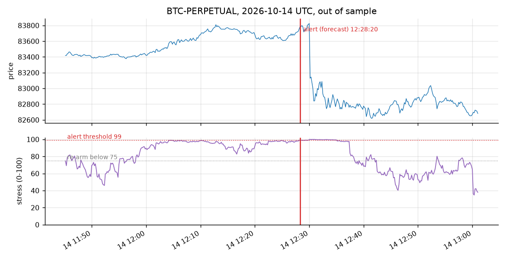
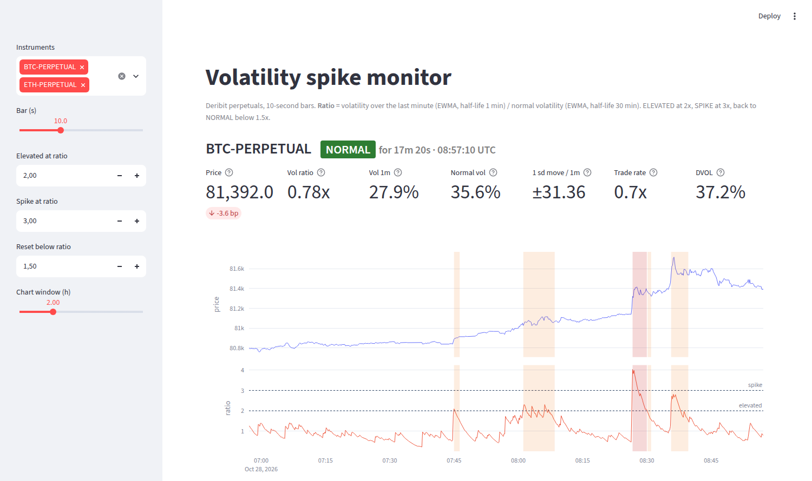
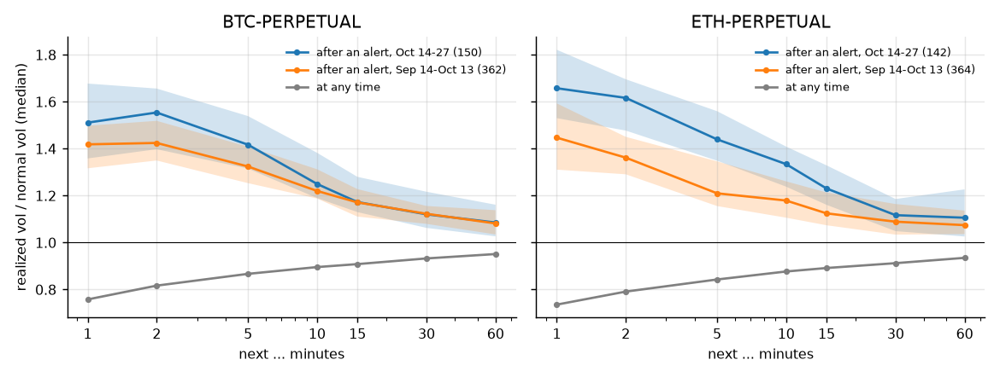

# volatility-engine

[](https://github.com/Thibautdqb/volatility-engine/actions/workflows/ci.yml)


A live monitor that flags short-term volatility spikes on BTC and ETH perpetuals (Deribit), updated every 10 seconds.

The monitor compares two volatilities measured on the same returns:

- **vol 1m**: how much the market moves right now (about the last minute);
- **normal**: how much it moved over the last half hour.

When vol 1m reaches 2× normal, the state goes to `ELEVATED`; at 3×, it goes to `SPIKE`. Each escalation is an alert, printed and optionally written to a JSON log.

The repository also replays the detector on the past trade tape and measures what its alerts were worth. Only Deribit's public API is used, so no account or key is needed.

```
10s bars | vol 1m = EWMA half-life 60s, normal = 30m | elevated >= 2x, spike >= 3x, reset < 1.5x | 08:56:20 UTC

                 price  state    for ratio vol 1m normal move 1m 1sd 1m trades  dvol
BTC-PERPETUAL 81,420.5 NORMAL 16m30s 0.77x  27.6%  35.8%  +0.1bp  31.05   0.5x 37.2%
ETH-PERPETUAL  2,369.9 NORMAL 17m50s 0.34x  18.0%  52.3%  -0.6bp   0.59   0.5x 52.3%

alerts
08:35:40  ETH-PERPETUAL    normal -> elevated  ratio 2.76x  vol 1m 158.7%  normal  57.5%  move 1m +38.1bp  @ 2,379.8  (history)
08:35:40  BTC-PERPETUAL    normal -> elevated  ratio 2.35x  vol 1m  72.2%  normal  30.7%  move 1m +18.3bp  @ 81,547.5  (history)
08:26:40  ETH-PERPETUAL    normal -> spike     ratio 4.20x  vol 1m 192.8%  normal  45.9%  move 1m +40.7bp  @ 2,373.9  (history)
08:26:40  BTC-PERPETUAL  elevated -> spike     ratio 4.04x  vol 1m  96.1%  normal  23.8%  move 1m +22.4bp  @ 81,322.0  (history)
08:26:30  BTC-PERPETUAL    normal -> elevated  ratio 2.60x  vol 1m  45.6%  normal  17.6%  move 1m  +7.5bp  @ 81,203.0  (history)
```



*The largest alert in the sample. At 12:30 UTC, BTC falls 0.9% in 30 seconds and 1.3% within three minutes. The ratio jumps to 5×. The monitor stays at SPIKE for about 4 minutes, then at ELEVATED, and returns to NORMAL 5½ minutes after the move. The ELEVATED alert at 12:05 is a smaller burst that faded on its own.*

---

## Dashboard

`streamlit run dashboard/app.py` shows the same monitor with the last hours of price and ratio, alert periods shaded (orange = elevated, red = spike), and the alert list.



## What each column means

| column | meaning | how a trader can use it |
|---|---|---|
| `state` | `NORMAL`, `ELEVATED` (ratio ≥ 2) or `SPIKE` (ratio ≥ 3); back to normal below 1.5 | widen quotes or stops, cut size, pause a strategy |
| `for` | time spent in the current state | a spike that has lasted 10 minutes is a regime, not a print |
| `ratio` | vol 1m / normal | unit-free, so the same thresholds hold for BTC and ETH, at night or during US hours |
| `vol 1m` | annualized volatility, EWMA with a 1-minute half-life | the current level |
| `normal` | annualized volatility, EWMA with a 30-minute half-life | the reference the ratio is measured against |
| `move 1m` | price change over the last minute | the direction of the move behind the alert |
| `1sd 1m` | one-standard-deviation price move over one minute at the current vol 1m | size stops and limit offsets in price units |
| `trades` | trades per bar, fast / slow average | activity often surges together with volatility |
| `dvol` | Deribit's 30-day implied volatility index | the options market's view, for context |

Alerts marked `(history)` were found in the three hours of trades loaded at start-up. They are listed so the alert list matches the charts, but they are not sent to the alert log.

Alerts are also written with `--log`, one JSON object per line. The record below comes from a replay of 2026-10-14; `dvol` is null because the replay has no DVOL feed.

```json
{"time": "2026-10-14T12:05:40+00:00", "instrument": "BTC-PERPETUAL", "level": "elevated", "previous": "normal", "ratio": 2.008927, "fast_vol": 0.476555, "slow_vol": 0.237218, "price": 83595.0, "move_1m": 3.6e-05, "dvol": null}
```

## Does it work?

The detector was replayed bar by bar on every Deribit trade over two periods:

- **2026-10-14 to 2026-10-27**: 14 days, 4.6 million BTC and 1.5 million ETH trades. The README was first written on this period.
- **2026-09-14 to 2026-10-13**: 30 days, 6.5 million BTC and 2.7 million ETH trades, held out and analyzed afterwards without changing anything.

The parameters (10-second bars, half-lives of 1 and 30 minutes, thresholds 2 / 3 / 1.5) were set from the alert frequency alone and were never tuned on the outcomes below. Reproduce with `volengine study BTC-PERPETUAL --end 2026-10-28 --days 14`, or `--end 2026-10-14 --days 30` for the held-out period.

**After an alert, is the next stretch of time more violent?** The sample is cut into non-overlapping 5-minute windows. For each window, the detector's state is read at its start, using past data only. A window is *violent* if its realized volatility is at least 2× the normal volatility at its start.

| | BTC Oct | BTC Sep (held out) | ETH Oct | ETH Sep (held out) |
|---|---:|---:|---:|---:|
| alerts per day (of which to `SPIKE`) | 15.4 (1.4) | 18.0 (2.0) | 14.6 (2.1) | 18.6 (2.7) |
| time spent flagged | 3.3% | 3.4% | 2.9% | 3.4% |
| P(next 5 min violent), state `NORMAL` | 1.8% [1.4, 2.2] | 2.0% [1.7, 2.3] | 1.9% [1.5, 2.4] | 2.2% [1.9, 2.6] |
| P(next 5 min violent), state `ELEVATED` | 12% [6, 17] | 10% [6, 13] | 17% [10, 25] | 10% [7, 14] |
| P(next 5 min violent), state `SPIKE` | 21% [0, 45] | 31% [15, 48] | 27% [10, 44] | 30% [17, 44] |
| **lift** (flagged / not flagged) | **7.2** [4.2, 10.8] | **6.2** [4.2, 8.5] | **10.1** [6.1, 15.2] | **5.9** [4.2, 7.8] |
| violent windows already flagged at their start | 20% [12, 27] | 18% [13, 23] | 24% [15, 32] | 17% [12, 22] |

95% intervals in brackets, from a stationary block bootstrap with one-hour blocks.

- Being flagged makes a violent next five minutes roughly 6 to 10 times more likely, on both instruments and in both periods.
- In every case, the lower bound of the interval is above 4.

**How long does it last?** The figure below shows realized volatility over the next 1 to 60 minutes after each new alert, relative to normal. Alerts are kept only if they are at least 30 minutes apart.



- In the minute after an alert, volatility runs at 1.4× to 1.7× normal. At a random moment the median is 0.75×.
- The excess halves in about 10 minutes and is nearly gone after an hour, at about 1.1×.
- **The alert does not predict the first jump.** About four out of five violent windows start while the monitor is still at `NORMAL`, because the move arrives in a single print (data releases, liquidations). The alert says that a high-volatility regime has started and that it tends to last several minutes. That is the information a trader can act on.

## Usage

```bash
git clone https://github.com/Thibautdqb/volatility-engine.git
cd volatility-engine
pip install -e ".[dashboard]"     # core only: pip install -e .
```

```bash
volengine live                                   # BTC and ETH
volengine live BTC-PERPETUAL --log alerts.jsonl --bell
volengine live --bar 5 --elevated 2.5            # every parameter can be changed
volengine study ETH-PERPETUAL --days 14          # replay and score on past trades
streamlit run dashboard/app.py                   # same monitor, with charts
```

At start-up, the monitor downloads the last three hours of trades (about 5 seconds) so that the normal volatility is meaningful from the first bar. `volengine study` caches downloaded days in `~/.cache/volengine`. The first run for 14 days of BTC takes a few minutes; later runs take seconds.

From Python:

```python
from volengine.live import LiveSpikeMonitor

monitor = LiveSpikeMonitor(["BTC-PERPETUAL"], on_alert=lambda a: print(a.as_dict()))
monitor.start_background()  # or: await monitor.run()
monitor.snapshot("BTC-PERPETUAL")  # Snapshot(level=..., ratio=..., fast_vol=..., sigma_1m=...)
```

## The model

On each 10-second bar, with r the log return of the last traded price:

```
fast ← λf · fast + (1 − λf) · r²     half-life 1 minute    (λf = 0.891)
slow ← λs · slow + (1 − λs) · r²     half-life 30 minutes  (λs = 0.9962)
ratio = √(fast / slow)
```

The state rises as soon as the ratio crosses 2 or 3 and falls back to `NORMAL` only below 1.5. This hysteresis stops the state from flickering when the ratio hovers around a threshold.

Design choices:

- **A ratio, not a level.** A 40% annualized vol is calm for ETH during US hours and agitated for BTC on a Sunday night. Comparing with the instrument's own recent level removes the need for per-asset or per-hour calibration.
- **Squared returns, not a robust estimator.** Jumps are exactly what should trigger an alert, so they are not filtered out.
- **10-second bars.** Over the 14 days, realized volatility from trade prices barely depends on the sampling interval: 32.0% at 1 s, 32.1% at 10 s and 34.1% at 1 min on BTC. So bid-ask bounce does not inflate short-interval estimates here. 10 s is fast enough to flag a move within one bar while leaving only 8% of BTC bars without a trade. ETH trades less (17% empty bars at 10 s), which lowers its 10-second vol by about 8% against 1-minute sampling. Because the signal is a ratio, a constant bias cancels.

## How it is built

- **One data definition.** Live bars come from the `trades.{instrument}.100ms` WebSocket channel. Historical bars come from the same trades on `history.deribit.com`. A bar's price is its last trade; a bar without a trade keeps the previous price. The streaming sampler and the batch sampler are tested to produce identical series.
- **Start-up without a hole or a duplicate.** The monitor subscribes first and buffers what arrives, downloads recent history, and runs the detector over it. It then replays the buffered trades that the download did not contain, matching them by trade id. A test checks that seeding followed by live trades gives exactly the same volatilities as a batch replay of the whole tape.
- **Bars close on time.** Bars close on exchange time, even when no trade prints. The DVOL feed ticks about once per second and closes any bar that ended more than one second earlier.
- **Reconnection.** Deribit heartbeats keep the connection alive, with exponential backoff on failure. After a reconnection, the monitor re-seeds from history so the gap is filled with real trades.

## Statistical design

- **No look-ahead.** The state is read at the start of each evaluation window, and the window's volatility uses only later returns.
- **Dependence.** Neighbouring windows are not independent because volatility clusters, so intervals use the stationary bootstrap (Politis & Romano, 1994) with one-hour blocks. Alerts in the after-alert curve are at least 30 minutes apart and resampled independently.
- **Checks under the null** (in `tests/`):
  - With Gaussian returns at constant volatility, the detector raises no alert in two simulated days.
  - With independent jumps but no volatility clustering, it raises alerts, as it should, but they predict nothing: the lift interval includes 1, and volatility after an alert is no higher than at a random time.
  - On simulated volatility bursts, the lift is clearly above 1. The real-data results above are therefore not produced by the method itself.
- **Coverage.** The stationary bootstrap and the Wilson interval are checked for coverage by simulation.

## Limitations

- **Six weeks of data.** The two periods together cover 44 days, which is short next to the variety of crypto market conditions. The `SPIKE` rows rest on 14 to 43 windows, hence their wide intervals.
- **Trade prices, not quotes.** Deribit does not publish historical order-book quotes, so both the study and the monitor use trades to stay identical. Quotes would give a cleaner price on illiquid instruments.
- **No intraday seasonality model.** The 30-minute normal level adapts to the time of day only gradually. In the sample, 13:00–14:00 UTC (around the US equity open) has more than twice the average hourly number of alerts, and 12:00–16:00 UTC accounts for about a quarter of them. This is intended: those are the hours when volatility actually changes.
- **Scope.** The study measures how violent the next minutes are, not their direction. It is not a trading signal by itself.

## Project layout

```
src/volengine/
  detector.py     fast/slow EWMA, ratio, alert levels with hysteresis
  sampling.py     trades -> regular bars (batch and streaming, identical)
  live.py         live monitor: seeding, buffering, alerts, snapshots
  study.py        replay on past trades, forward-volatility evaluation
  stats.py        stationary bootstrap, Wilson interval
  deribit/        REST trade history (paginated) and WebSocket stream (heartbeat, reconnect)
  cli.py
dashboard/app.py  Streamlit front-end
scripts/          figure generation
tests/            unit tests + integration tests against Deribit (pytest -m network)
```

```bash
pip install -e ".[dev]"
pytest -m "not network"
pytest -m network
ruff check . && ruff format --check .
```

## References

- J.P. Morgan / Reuters (1996). *RiskMetrics Technical Document*, exponentially weighted volatility.
- Andersen, Bollerslev, Diebold & Labys (2000). Great realizations. *Risk*, realized volatility and the sampling frequency.
- Politis & Romano (1994). The stationary bootstrap. *JASA*.
- Wilson (1927). Probable inference, the law of succession, and statistical inference. *JASA*.

## License

MIT
