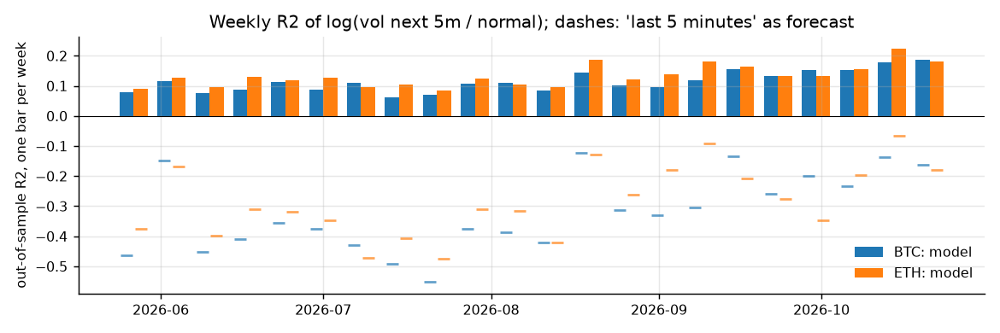
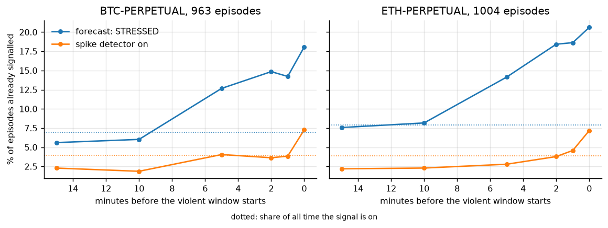
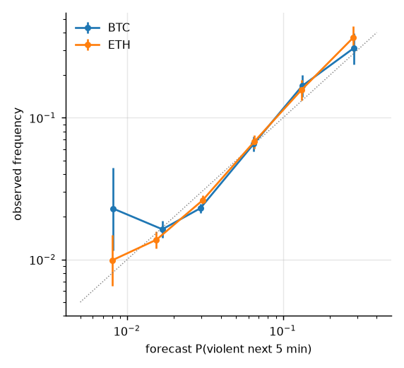

# volatility-engine

[](https://github.com/Thibautdqb/volatility-engine/actions/workflows/ci.yml)


A volatility-stress indicator for BTC and ETH perpetuals on Deribit. It sends one alert when the market starts to move, to a terminal, a desktop, a phone (ntfy) or a Discord or Slack webhook.

- **The score.** Every 10 seconds, from the live trade feed, each instrument gets a **stress score from 0 to 100**. The score is the rank of the forecast volatility of the next five minutes among the forecasts seen in training.
- **The alert.** An alert is sent when stress reaches 99, or when a spike is already under way. It is sent once per episode, and the alarm re-arms only after stress has fallen back below 75 and at least 30 minutes have passed.
- **What it does not do.** It does not say which way the market will go (see [What does not work](#what-does-not-work)).

```bash
volengine watch --notify ntfy:<your-topic>          # phone, via the ntfy app
volengine watch --notify desktop --notify webhook:<discord-or-slack-url>
```

```
watching BTC-PERPETUAL, ETH-PERPETUAL: alert when stress >= 99 or a spike is under way; notify: terminal
[12:49 UTC] BTC stress 58.3 (normal)  ETH stress 59.2 (normal)
[12:50 UTC] BTC stress 56.9 (normal)  ETH stress 57.5 (normal)
```


*2026-10-14, out of sample. The model is the one the walk-forward used that week, fitted on 2026-07-16 to 2026-10-13 only.*

- Stress has been climbing since 12:00 and crosses 99 at 12:28:20, so the alert goes out then. US data are released at 12:30 UTC, and the time-of-day term knows that this slot is usually volatile.
- At 12:30, BTC falls 0.9% in 30 seconds.
- Stress drops back below 75 at about 12:40, which re-arms the alarm.

This is one illustration. The evidence is below.

## What the alerts are worth

The live alarm (the same code, `StressAlarm`) was replayed bar by bar over the 22 out-of-sample weeks, May 27 to October 27, 2026.

| threshold | alerts per day (BTC / ETH) | a violent 5 minutes starts within 10 min of the alert | at a random moment | episodes alerted between 10 min before and 2 min after their start |
|---:|---:|---:|---:|---:|
| 98 | 7.3 / 10.0 | 31% / 29% | 9% | 33% / 43% |
| **99 (default)** | **5.3 / 7.1** | **35% / 33%** | 9% | 29% / 36% |
| 99.5 | 4.3 / 5.4 | 37% / 37% | 9% | 25% / 30% |

*Violent* means a realized volatility of at least 2× normal over the five minutes.

- **What an alert means.** With the default threshold, an alert is followed by a violent five minutes 3.6 to 3.8 times as often as a random moment.
- **What it misses.** It does not catch every episode: most violent moves start from a single print that nothing announced.
- **Tuning.** `--threshold` trades frequency for precision, and `--no-spike` keeps only alerts that come ahead of the move.
- **Source.** The full tables are in [`docs/results/`](docs/results).

---

## Results

Walk-forward over 2026-05-27 to 2026-10-27, for BTC and ETH separately:

- **Refits.** Every week, the model is refitted on the previous 28 to 90 days and forecasts every 10-second bar of the following week, as it would have live.
- **Sample.** That gives 22 weeks and about 44,000 non-overlapping five-minute windows per asset, all out of sample.
- **Inference.** Standard errors are HAC with a one-hour window. Intervals come from a stationary block bootstrap with one-hour blocks.

The complete output is in [`docs/results/`](docs/results), and `python scripts/make_figures.py` regenerates it.

### Accuracy

Target: log(realized volatility over the next five minutes / normal volatility), where *normal* is a 30-minute EWMA.

| forecast | BTC R² | DM t vs model | ETH R² | DM t vs model |
|---|---:|---:|---:|---:|
| **model** | **0.107** | | **0.129** | |
| training-period mean | 0 | −22.5 | 0 | −26.4 |
| volatility of the last 30 minutes | −0.072 | −29.6 | −0.093 | −36.2 |
| volatility of the last 5 minutes | −0.357 | −30.6 | −0.297 | −46.3 |
| volatility of the last minute (spike detector) | −0.366 | −43.0 | −0.390 | −53.7 |

- **Significance.** The model has a lower loss than every simple alternative, with Diebold-Mariano t-statistics between −22 and −54.
- **Every week.** Its R² is positive in **22 of 22 weeks** on both assets: the minimum is 0.062 on BTC and 0.086 on ETH.
- **Scale.** The Mincer-Zarnowitz slope is 1.01 (HAC se 0.02) on both assets, so the forecasts have the right scale.



### Does it anticipate?

**Discrimination of P(violent)** (AUC; 0.5 = no information):

| | BTC | ETH |
|---|---:|---:|
| all windows | 0.662 [0.643, 0.679] | 0.696 [0.682, 0.711] |
| windows where the spike detector is quiet | **0.625** [0.605, 0.643] | **0.661** [0.646, 0.678] |
| spike detector alone | 0.653 | 0.673 |

The second row is the anticipation test: before anything unusual shows in the last minute, the probability still ranks the coming windows well above chance.

**Lead time.** A violent episode starts at a five-minute window whose realized volatility reaches 2× normal after a window that did not. Episodes closer than 30 minutes are merged, which leaves 963 on BTC and 1,004 on ETH. The table gives the share of episodes for which each signal was already on, *L* minutes before the episode began:

| minutes before | BTC: `STRESSED` | BTC: spike detector | ETH: `STRESSED` | ETH: spike detector |
|---:|---:|---:|---:|---:|
| 0 | 18.1% | 7.3% | 20.6% | 7.2% |
| 2 | 14.8% | 3.6% | 18.4% | 3.8% |
| 5 | 12.7% | 4.0% | 14.1% | 2.8% |
| 10 | 6.0% | 1.9% | 8.2% | 2.3% |
| share of all time the signal is on | 7.0% | 3.9% | 7.9% | 3.9% |



- **A real warning window.** `STRESSED` is on about 7% of the time but already covers 13–21% of episodes in the five minutes before they start, 1.8 to 2.6 times its base rate. The spike detector stays close to its own base rate until the episode starts, as expected from a coincident signal.
- **About 5 minutes, not 15.** Ten minutes out, the warning is back to its base rate.
- **Most episodes come unannounced.** Four out of five start while the regime is not `STRESSED`. Those moves come from a single print (a release, a liquidation) that the past five minutes did not foreshadow.

### Calibration and regimes

 

- **Calibration.** The probability is calibrated within its confidence intervals up to about 10%. Above that it is slightly low: forecasts of 13% come true 16–17% of the time, and forecasts of 28–29% come true 31–37% of the time. The Brier skill against the training-period base rate is +0.026 on BTC and +0.034 on ETH.
- **Regimes.** They order the risk monotonically:

| regime | share of time (BTC / ETH) | next 5m vol / normal, median | P(violent) BTC | P(violent) ETH | spike detector quiet |
|---|---:|---:|---:|---:|---:|
| `CALM` | 16% / 17% | 0.70 / 0.68 | 1.7% | 1.2% | 100% |
| `NORMAL` | 52% / 50% | 0.81 / 0.81 | 1.8% | 1.9% | 99% |
| `ACTIVE` | 25% / 26% | 0.95 / 0.94 | 3.2% | 3.6% | 94–96% |
| `STRESSED` | 7% / 7% | 1.19 / 1.16 | **10.6%** [9.4, 11.7] | **10.7%** [9.6, 11.8] | 69–70% |

### Does it generalize?

`python scripts/research.py` reproduces the tables in this section.

| walk-forward R² | BTC | ETH |
|---|---:|---:|
| fitted on its own history | 0.107 | 0.129 |
| fitted on the *other* asset only | 0.101 | 0.118 |
| fitted on both | 0.107 | 0.126 |

- **Across assets.** A model fitted on ETH forecasts BTC almost as well as BTC's own, and the other way round. The relationship is not specific to one asset. Instruments without their own model get the model fitted on both assets.
- **Across time.**
  - The R² is positive in every one of the 22 test weeks.
  - Longer training windows help on both assets: R² is 0.116, 0.121 and 0.123 on BTC, and 0.134, 0.140 and 0.143 on ETH, with windows of 28, 56 and 90 days. The relationship is stable rather than drifting.
  - Across the 22 weekly refits, the coefficients barely move. On BTC: `x30` 0.26 ± 0.02, `x5` 0.14 ± 0.01, time of day 0.83 ± 0.02, weekend −0.09 ± 0.02 (mean ± standard deviation).

### What does not work

`scripts/research.py` reproduces both points.

- **More inputs.** Inputs were selected on May–July only, with a rule fixed in advance: keep an input group if it raises the walk-forward R² by at least 0.002, on average over BTC and ETH.
  - The groups kept: 4-hour and 1-day volatility, and the weekend flag, each worth +0.004 to +0.005.
  - The groups rejected: order-flow imbalance and liquidation volume, worth +0.0007 each.
  - On August–October, seen once at the end, the chosen set beats the base set on both assets: R² 0.122 against 0.118 on BTC, and 0.143 against 0.132 on ETH.
- **Direction.** Four candidate signals were tested against the next 1, 5 and 15 minutes' return:
  - order-flow imbalance over the last minute;
  - the last move;
  - the perpetual's premium over the spot index;
  - the index moving first.

  One effect is stable: order-flow imbalance continues over the next minute. Its rank correlation is 0.01–0.08, and following the top and bottom deciles earns 0.1 to 1.0 bp per minute (t between 2.6 and 17). That is far below the ≈10 bp round trip of a taker, and it shrinks from May–July to August–October. **The tool tells you how much the market is likely to move, not which way.**

---

## Data engineering

```
Deribit history server ──(REST, paginated, 8 req/s cap, retries)──► per-day download
        │                                                                │
        │                        check trade_seq contiguity, re-download around holes
        ▼                                                                ▼
WebSocket trades.{instrument}.100ms           Parquet store: trades/v1/<instrument>/<day>.parquet
        │                                     + manifest <day>.json (counts, seq range, holes)
        ▼                                                                │
 sequence check ─► 10-second bars ◄────── same rules ─────── 10-second bars (cached per day)
        │                                                                │
        ▼                                                                ▼
   live monitor  ◄─── seeded from stored days + REST for today      backtest / fit
```

- **Completeness can be proven.** Deribit numbers each instrument's trades with a `trade_seq` that increases by exactly one. A day is complete when its sequence numbers are contiguous and the first one follows the previous day's last.
  - Holes are re-downloaded. A hole that cannot be filled stays flagged in the day's manifest; it is never ignored silently.
  - The stored sample holds 34.7 million trades over 184 days: 0 missing sequence numbers, 0 duplicates, 0 holes across midnight (`volengine data status`).
- **Only book trades make prices.** Block trades (negotiated off-book) and combo legs (priced by the spread) are stored and flagged but excluded from the bars. Over the sample they number 3,018 and 29,595 on BTC.
- **One definition of a bar, live and historical.** The last trade in sequence order sets a bar's price, and a print stamped in a bar that has already closed is ignored. The streaming and batch implementations are tested to give identical bars, inputs and forecasts, to 1e-9.
- **Safe writes, incremental runs.**
  - Every file is written to a temporary name and renamed, so an interrupted run never leaves a truncated file.
  - Only complete UTC days are stored, and a sync downloads only what is missing.
  - Bar caches rebuild themselves when their source day changes.
- **The live feed is checked too.**
  - A jump in `trade_seq` triggers a lookup of the missing trades on the history server. If one of them was a book trade, the monitor re-seeds; block or combo trades alone are noted and skipped.
  - Latency from exchange timestamp to receipt is shown, typically 100–300 ms.
  - Bars close on exchange time even without trades (the DVOL feed ticks twice a second).
- **Fast start.** The monitor needs 26 hours of history: the detector's warm-up plus the 1-day input. Stored days are read from disk; the rest is downloaded in parallel 2-hour slices, about 25 seconds for a full day of BTC.

## The model

Every input is known at the close of the bar and expressed relative to normal volatility, so it is unit-free across assets and calendar periods. Least squares on non-overlapping five-minute windows:

| input | definition | BTC coefficient (shipped) |
|---|---|---:|
| `x1`, `x5`, `x30`, `x4h`, `x1d` | ½ log(realized variance over the last 1 m, 5 m, 30 m, 4 h, 1 d / normal variance) | +0.02, +0.19, +0.24, +0.09, +0.02 |
| `season` | usual log volatility of the coming 5-minute slot of the day, from the training days | +0.79 |
| `trades` | log(trades in the last minute / average per minute over 30 minutes) | +0.05 |
| `absmove` | \|price change over the last minute\| in normal standard deviations | +0.04 |
| `weekend` | 1 on Saturday and Sunday (UTC) | −0.08 |

- **Volatility terms.** The first five form a heterogeneous autoregression (Corsi, 2009) moved to intraday horizons.
- **Probability.** P(violent) comes from a logistic regression of the event on the forecast and its square, fitted on the same training windows. The curve is constrained never to decrease as the forecast rises.
- **Regimes.** The cut points are the 25th, 75th and 95th percentiles of the training forecasts. A regime rises as soon as a cut point is crossed and falls back only after one minute below it. That hysteresis cuts the number of regime changes from 33–39 to 15–17 per hour.
- **Shipped coefficients.** `src/volengine/models.json` holds models fitted on the last 90 days for BTC, ETH, and both together. `volengine fit` re-estimates them from the local store.

## Usage

```bash
git clone https://github.com/Thibautdqb/volatility-engine.git
cd volatility-engine
pip install -e ".[dashboard]"
```

```bash
volengine watch                                  # alerts only; works without a local store
volengine watch --notify desktop --notify ntfy:<topic> --notify file:alerts.jsonl
volengine watch --test --notify ntfy:<topic>     # check delivery
volengine live                                   # full table: stress, forecast, P(violent)
streamlit run dashboard/app.py

volengine data sync --start 2026-04-28           # download and verify (about 30 min for 6 months)
volengine data status
volengine backtest ETH-PERPETUAL --end 2026-10-28
volengine fit --days 90 --out models.json        # then: volengine live --models models.json
```

The store lives in `~/.cache/volengine`; set `VOLENGINE_DATA` to move it.

- **Contents of an alert.** Each alert carries a title (instrument, stress, reason) and a line with the forecast volatility of the next five minutes, P(violent), the one-standard-deviation move in USD, the price and the move of the last minute.
- **JSON log.** With `file:<path>`, the same fields are written as one JSON object per line: `time`, `instrument`, `reason`, `stress`, `p_violent`, `forecast_ratio`, `forecast_vol`, `sigma_5m`, `price`, `move_1m`, `ratio`, `slow_vol`, `dvol` and `live`.


## Statistical design

- **No look-ahead.** Every input is known at the close of its bar, and the target uses only later returns. The training window of every refit ends before its test week begins; a test enforces this.
- **Everything is estimated on the training window.** That covers the coefficients, the time-of-day profile, the probability calibration and the regime cut points.
- **Selection and confirmation are separate.** Inputs were chosen on May–July with a rule fixed in advance; August–October and the second asset confirm.
- **Dependence.** Neighbouring windows are not independent, hence HAC errors and block-bootstrap intervals. The Diebold-Mariano test's size under dependent losses is checked by simulation in the test suite.
- **Market closures.** Five-minute windows without any price change are dropped from fitting and scoring.
- **Null checks** (in `tests/`). With fat-tailed returns but no volatility memory, the forecast has no skill (R² < 0.02, AUC ≈ 0.5). With volatility clusters, it beats the naive forecasts.

## Limitations

- **Six months, two assets, one venue.** The models are re-estimated weekly in the backtest; live, `volengine fit` should be rerun regularly.
- **The first jump.** Four out of five violent episodes are not announced. The model shifts the odds; it does not see releases or liquidations coming.
- **The probability is slightly low in the tail.** Above 10%, it is low by a few points.
- **Trade prices, not quotes.** Deribit publishes no historical order book, so both the backtest and the monitor use trades to stay identical.

## Project layout

```
src/volengine/
  data/           schema and integrity checks, Parquet store, sync and repair, bars
  deribit/        REST client (rate cap, retries, parallel slices), WebSocket stream
  features.py     forecast inputs, batch and streaming
  forecast.py     model, probability, regimes, streaming forecaster
  detector.py     spike detector: 1-minute vs 30-minute EWMA with hysteresis
  evaluation.py   walk-forward, accuracy, calibration, regimes, anticipation
  stats.py        HAC, Diebold-Mariano, stationary bootstrap, AUC, Wilson
  live.py         live monitor: seeding, sequence checks, alerts
  cli.py
dashboard/app.py
scripts/          research.py (modelling decisions), make_figures.py (results)
docs/results/     full backtest output per instrument
tests/            unit tests; integration tests against Deribit with -m network
```

```bash
pip install -e ".[dev]"
pytest -m "not network" && pytest -m network
ruff check . && ruff format --check .
```

## References

- Andersen, Bollerslev, Diebold & Labys (2003). Modeling and forecasting realized volatility. *Econometrica*.
- Corsi (2009). A simple approximate long-memory model of realized volatility. *Journal of Financial Econometrics*.
- Diebold & Mariano (1995). Comparing predictive accuracy. *JBES*.
- Mincer & Zarnowitz (1969). The evaluation of economic forecasts. *NBER*.
- Newey & West (1987). A simple, positive semi-definite, heteroskedasticity and autocorrelation consistent covariance matrix. *Econometrica*.
- Politis & Romano (1994). The stationary bootstrap. *JASA*.

## License

MIT
